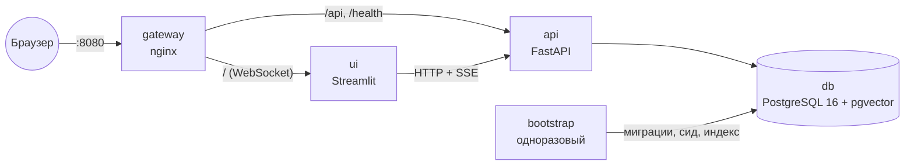
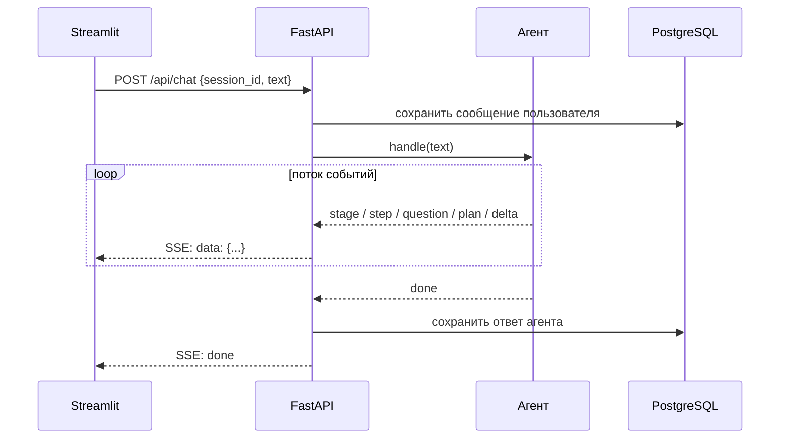
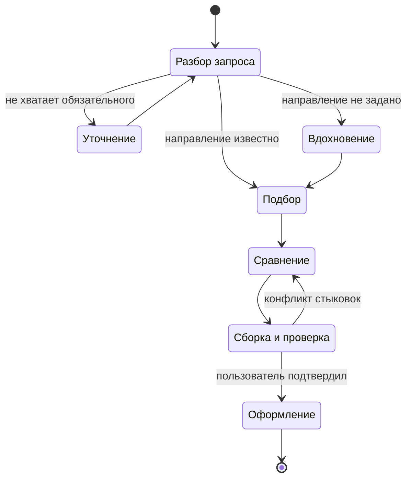

# Архитектура TripPilot

Описание архитектуры решения для трека «О!дин запрос». У каждой части указан статус: **реализовано** или **план** (с номером этапа).

## Назначение и главный принцип

Агент принимает сообщение в свободной форме («к тёплому морю в ноябре, недорого, с ребёнком») и ведёт пользователя по этапам: вдохновение → выбор направления → подбор и сравнение → сборка поездки → покупка (имитация).

**LLM понимает запрос и формулирует объяснения, а решения и проверки выполняет детерминированный код.** Цены, даты и наличие берутся только из данных и инструментов, модель их не генерирует. Поэтому результат воспроизводим, проверяем тестами и не содержит выдуманных чисел.

## Сервисы



| Сервис | Роль | Порт | Статус |
|---|---|---|---|
| `gateway` | единственная точка входа: `/` → UI, `/api` и `/health` → API | 8080, проброшен наружу | реализовано |
| `ui` | Streamlit: тонкий клиент, только отрисовка | 8501, внутри сети | реализовано (заглушка интерфейса) |
| `api` | FastAPI: агент, сервисы, хранение диалогов | 8000, внутри сети | реализовано |
| `bootstrap` | миграции Alembic → сидирование → RAG-индекс, затем завершается | — | реализовано (индексация — этап 3) |
| `db` | PostgreSQL 16 с расширениями `vector`, `pg_trgm`, `unaccent` | 5432, внутри сети | реализовано |

Порядок запуска задаётся healthcheck'ами: `db` готова → `bootstrap` завершился успешно → `api` здоров → `ui` здоров → `gateway`. Всё поднимается одной командой `docker compose up --build` без ручных шагов.

Шлюз:
- проксирует WebSocket Streamlit;
- отдаёт поток событий агента (SSE) без буферизации;
- разрешает имена сервисов через DNS Docker при каждом запросе, поэтому пересоздание контейнера не ломает маршрутизацию.

## Слои кода

```
src/trip_pilot/
├── domain/      ядро: чистые модели, без IO
├── agent/       ядро: оркестратор, протокол событий, инструменты
├── planning/    ядро: фильтрация, скоринг, сборка пакетов, проверки (план, этап 1–2)
├── services/    ядро: стоимость, объяснения, бронирование (план)
├── adapters/    реализации: БД (SQLAlchemy async), LLM, источники данных
├── rag/         база знаний: pgvector + полнотекстовый поиск
├── seed/        сидирование справочников и синтетики
├── api/         приложение: FastAPI
└── ui/          приложение: Streamlit
```

**Правило зависимостей:** ядро (`domain`, `agent`, `planning`, `services`) не импортирует ни БД, ни HTTP, ни Streamlit. Оно работает через интерфейсы, которые реализуют адаптеры; связывание происходит при старте API. Что это даёт:
- синтетические источники данных заменяются реальными API без правок ядра;
- ядро тестируется без базы и LLM;
- один и тот же API обслуживает веб-интерфейс, а в будущем бота и прогон тестовых сценариев.

## Ход запроса



Ответ агента сохраняется **до** отправки `done`: клиент вправе закрыть соединение сразу после этого события. Состояние диалога живёт в PostgreSQL, а не в памяти процесса, поэтому перезагрузка страницы не теряет переписку (id диалога хранится в адресе `?sid=`), а API можно запускать в нескольких репликах.

### Протокол событий (реализовано)

| `type` | Поля | Назначение |
|---|---|---|
| `stage` | `stage` | агент перешёл на стадию (intake, clarify, search…) |
| `step` | `text` | что агент делает сейчас («Ищу перелёты Москва → Анталья») |
| `question` | `text`, `options` | уточняющий вопрос с вариантами-кнопками |
| `plan` | `data` | текущее состояние плана поездки для панели справа |
| `delta` | `text` | фрагмент текстового ответа (потоковый вывод) |
| `error` | `text` | ошибка, понятная пользователю |
| `done` | — | ход агента завершён |

## Агент (план, этап 1+)

Порядок стадий задаёт детерминированная машина состояний, а LLM работает внутри стадий: разбирает текст в структуру запроса, выбирает параметры инструментов, формулирует ответ. Так поведение предсказуемо даже на незнакомых запросах.



- **Уточнения.** Агент спрашивает только то, без чего нельзя искать (город вылета, примерные даты, возраст детей), не больше одного хода до первой рекомендации. Остальное он додумывает сам и показывает как допущение, которое пользователь может поправить («перелёт ≤ 5 ч ✎»).
- **Сравнение.** Агент предлагает три пакета с Парето-фронта (эконом, баланс, комфорт), а не длинную выдачу. Объяснение «почему подходит / чем пожертвовали / какие риски» строится из тех же чисел, по которым шло ранжирование.
- **Пересборка.** План — граф узлов (направление, перелёты, отель, трансфер, пакет). Изменение условия пересчитывает только зависимые узлы: «на два дня позже» не трогает направление, «бюджет меньше» пересобирает пакет из уже найденных вариантов. Пользователь видит, что именно изменилось.
- **Ошибки ввода** обрабатываются в стиле Railway Oriented Programming (библиотека `returns`). Каждая ошибка типизирована и превращается в действие агента: неизвестный город → «Вы имели в виду…?», нет результатов → предложение ослабить условие с ценой каждого варианта.
- **Подтверждение.** Перед оформлением (необратимое действие) агент всегда спрашивает подтверждение.

## Данные

### PostgreSQL (реализовано)

| Таблица | Содержимое |
|---|---|
| `destination` | справочник направлений: координаты, IATA, IANA-часовой пояс; триграммный индекс для нечёткого поиска по названию |
| `chat_session`, `chat_message` | диалоги и сообщения |
| `kb_document`, `kb_chunk` | база знаний RAG: документы, фрагменты, эмбеддинги `vector(1024)`, полнотекстовый индекс `tsvector` (russian), метаданные `jsonb` |

Схема меняется только миграциями Alembic. Bootstrap идемпотентен: повторный запуск ничего не дублирует.

### RAG (схема реализована, индексация — этап 3)

RAG отвечает за **знания**, SQL — за **факты**:

| В базе знаний (текст) | В таблицах (факты) |
|---|---|
| путеводители, чем заняться с детьми | цены, наличие, расписания |
| правила: въезд, животные, багаж, документы на ребёнка | климат по месяцам |
| политики отелей: отмена, ранний заезд | характеристики отелей |
| отзывы (для цитат) | агрегированные оценки отелей по аспектам |

Поиск:
1. полнотекстовый (PostgreSQL, словарь `russian`) и векторный (pgvector) поиск с фильтрами по направлению, месяцу и типу документа;
2. слияние результатов через Reciprocal Rank Fusion;
3. MMR, чтобы фрагменты не повторяли друг друга;
4. в ответе — цитаты с источниками.

Без ключа LLM работает только полнотекстовый поиск.

### Источники данных

Каталог отелей, перелётов и трансферов в прототипе **синтетический**. Это помечено в интерфейсе («демо-данные») и в данных (флаг `is_synthetic`). Инвентарь генерируется относительно текущей даты, чтобы даты в выдаче всегда были в будущем (план, этап 1).

Открытые данные, которые используем:
- справочник направлений: реальные координаты, коды аэропортов и часовые пояса (реализовано);
- климат: Open-Meteo (план);
- путеводители: Wikivoyage, лицензия CC BY-SA, с атрибуцией (план).

## Ключевые алгоритмы (план)

| Алгоритм | Где применяется |
|---|---|
| Гибридный поиск + RRF, MMR | RAG, разнообразие предлагаемых направлений |
| Триграммы и словарь алиасов | «Масква», «Питер», «СПб» → нужный город |
| Многокритериальный скоринг с разложением вклада | ранжирование и объяснение из одних чисел |
| Beam search + Парето-фронт | сборка трёх пакетов из тысяч комбинаций |
| Поиск с равномерной стоимостью по ослаблениям | вместо «ничего не найдено» — ближайшие варианты с ценой |
| Граф зависимостей + топологический порядок | пересборка только затронутых частей плана |
| Префиксные суммы по календарю цен | «сдвиг на +2 дня дешевле на N ₽» |
| Connection Scan Algorithm | мультимодальные стыковки (самолёт + поезд) |
| Проверка таймлайна в местных часовых поясах | стыковки, прилёт ночью, время заезда |

## Надёжность и эксплуатация

- `/health` проверяет доступность БД: `200 {"status":"ok"}` или `503`; healthcheck есть у каждого долгоживущего сервиса (реализовано).
- Процессы работают от непривилегированных пользователей; образ собирается в несколько стадий; версии образов и пакетов закреплены (`uv.lock`) (реализовано).
- Логи пишутся в stdout и видны в `docker compose logs` (реализовано).
- CI: линтер, тесты и запуск стека с проверкой `/health` (реализовано).
- Режим без LLM: если ключ не задан, разбор запроса идёт по правилам, объяснения — по шаблонам (план, этап 1).
- Ограничение числа одновременных запросов к LLM, таймауты и повторы (план).

## Дорожная карта

| Этап | Содержание | Статус |
|---|---|---|
| 0 | каркас: шлюз, API, UI, БД с pgvector, миграции, bootstrap, CI | готово |
| 1 | сквозной сценарий на синтетике: запрос → подбор → пакеты → план → имитация оплаты | в работе |
| 2 | уточнения и допущения, объяснения, проверка стыковок с таймлайном | план |
| 3 | RAG: путеводители, правила, отзывы; пересборка плана; ослабление условий | план |
| 4 | набор тестовых запросов и метрики качества агента, память между сессиями, работа после покупки | план |
